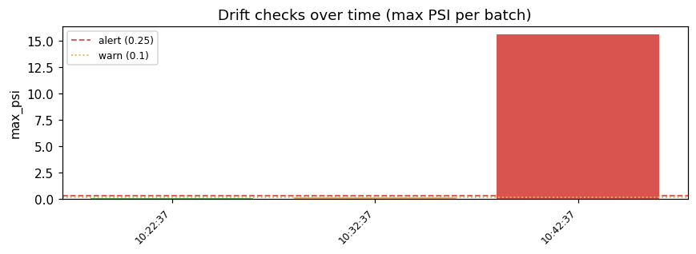
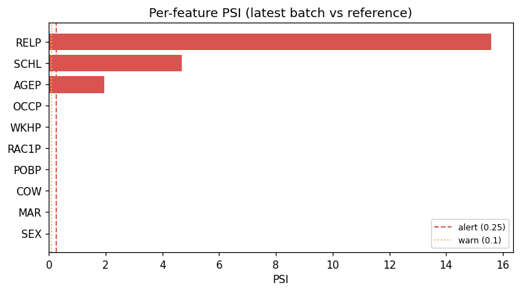

# DriftWatch

Monitor a **deployed ML model for data drift using only its inputs — no ground-truth labels required.**

DriftWatch is two things in one repo:

1. **A live monitoring service** — a FastAPI app that scores your deployed model against a stored reference sample
   and shows the result on a self-contained dashboard.
2. **A research study** — does label-free drift (PSI, KS, domain-classifier AUC) predict *real* accuracy loss across
   natural US Census shifts? (income prediction, ACS 2018, 15 states).

> Live demo: [https://driftwatch-0tk3.onrender.com/dashboard](https://driftwatch-0tk3.onrender.com/dashboard) ·
> API docs: [https://driftwatch-0tk3.onrender.com/docs](https://driftwatch-0tk3.onrender.com/docs)

---

## Why label-free drift monitoring?

Once a model is deployed, you rarely have true labels in real time. So you can't measure accuracy directly.
DriftWatch detects that the *inputs* are changing relative to what the model trained on —
a leading indicator that accuracy may drop. It rates every batch:

| Status | Condition (max PSI) |
|---|---|
| ✅ `ok` | < 0.10 |
| ⚠️ `warn` | 0.10 – 0.25 |
| 🚨 `alert` | ≥ 0.25 |

## Dashboard

The dashboard renders the monitor status, the per-batch history, and the top drifting features (charts are drawn
server-side with matplotlib and embedded as base64 — no internet/CDN needed).





## Quickstart (Windows PowerShell)

```powershell
cd C:\Users\Pritesh\Downloads\driftwatch\driftwatch
.venv\Scripts\Activate.ps1            # activate env (one-time per shell)
python -m uvicorn api.app:app --reload --port 8001
```

Then open:

- Dashboard → http://127.0.0.1:8001/dashboard
- API docs  → http://127.0.0.1:8001/docs

> Note: use port `8001` if `8000` is already taken on your machine.
>
> First-time-only setup (if you have not built the model yet): `python -m venv .venv`, `pip install -r requirements.txt`,
> `python train_service_model.py` (needs internet; add `--synthetic` to use test data).

## API reference

| Method | Endpoint | Description | Example |
|---|---|---|---|
| `GET` | `/health` | Model status + required features | `Invoke-RestMethod http://127.0.0.1:8001/health` |
| `POST` | `/predict` | Score a batch → `probability_income_over_50k` + `prediction` | JSON `{"records":[{...10 features...}]}` |
| `POST` | `/drift` | Check a batch for drift → status + per-feature scores | JSON `{"records":[{...}]}` |
| `GET` | `/dashboard` | HTML dashboard | browser |
| `GET` | `/drift-data` | Latest check + history as JSON | `Invoke-RestMethod http://127.0.0.1:8001/drift-data` |

All features: `AGEP COW SCHL MAR OCCP POBP RELP WKHP SEX RAC1P`.

## How the drift scores work

All scores compare a **new batch** to a stored **reference sample** of the model's training data. None need labels.

- **PSI (Population Stability Index)** — bins each feature into the same buckets as the reference, then measures how
  much the *distribution* of the batch has shifted. PSI is the headline score and drives the ok/warn/alert status.
- **KS (Kolmogorov–Smirnov)** — the largest vertical gap between the batch's and reference's *cumulative* distributions
  for a numeric feature. Catches location shifts PSI can smooth over.
- **Domain-classifier AUC** — train a quick classifier to tell "reference row" vs "new row" apart. AUC ≈ 0.5 means the
  new data is indistinguishable from reference (no drift); AUC → 1.0 means the new data is highly separable (strong drift).
- **`pred_shift`** — the model-aware signal (the study's best predictor): how much the model's *average output probability*
  moved from its reference value.

Each per-feature score is computed, then aggregated into a single `status` via the thresholds above.

## Research summary

**Question:** across real state-to-state census shifts, which kinds of shift explain accuracy loss, and how much of it do
common drift scores capture?

**Setup:** train on one source state, evaluate on every other state (15 states → 210 pairs), recording both drift scores
(no labels) and the true accuracy drop. Two tasks (income, employment) and a temporal 2018→2019 run.

**Key findings** (see `docs/PAPER.md` and `docs/RESEARCH_GAP.md` for the full story):
- Drift scores track accuracy loss for **input** shifts well, but miss **label shift** (a change in the base rate), because
  input-only scores can't see the label distribution change.
- `pred_shift` (the model's output drift) is the strongest, most consistent predictor of accuracy loss.
- Standard fixed thresholds (0.10 / 0.25) are reasonable defaults but are not calibrated to any specific model.

## Repo layout

```
api/                 # FastAPI service (app.py, dashboard.py)
driftwatch/          # research pipeline (data, drift, model, experiment, monitor)
tests/               # pytest suite (28 tests)
data/ artifacts/     # datasets, trained model, reference sample, monitor history
outputs/             # experiment results (CSV + charts), archive/ for older runs
docs/                # paper, research gap, handoff, presentation guide
```

## Docs

| Document | Purpose |
|---|---|
| `docs/PAPER.md` | paper draft |
| `docs/RESEARCH_GAP.md` | the research gap, how to explain it |
| `docs/PRESENTATION_GUIDE.md` | full presentation script |
| `docs/HANDOFF.md` / `docs/PROJECT_STRUCTURE.md` | repo briefing for a new developer |
| `docs/DEPLOYMENT.md` | how the app is deployed to Render |
| `docs/CODE_GUIDE.md` | code-only map of the repo |

## Limitations

- One primary task (income), tabular data, one survey year (temporal run is a 15-row pilot).
- Source states share a model, so pairs are not fully independent; bootstrap intervals are approximate.
- Synthetic results in this repo are for testing only; the deployed demo uses seeded demo data.
- The free-tier Render instance sleeps after ~15 min idle (cold start ~30–60 s) — fine for a demo, not continuous monitoring.
